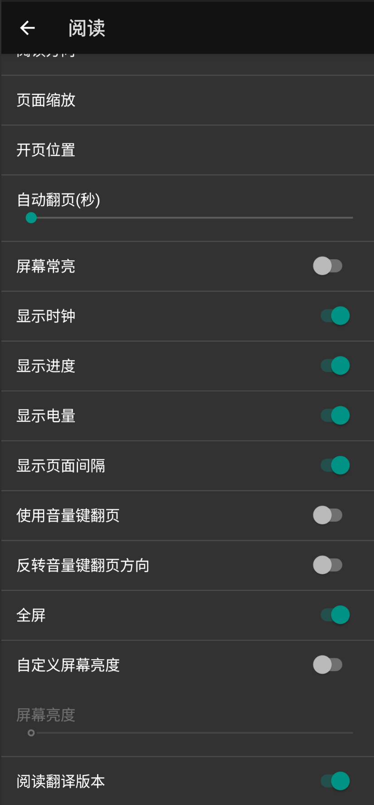
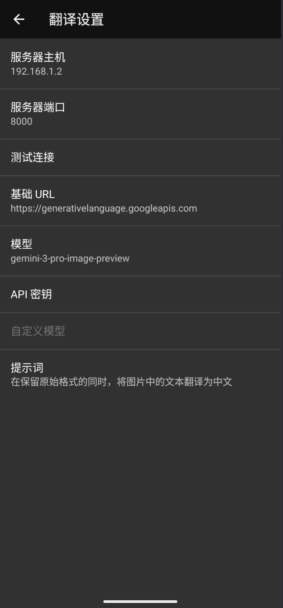
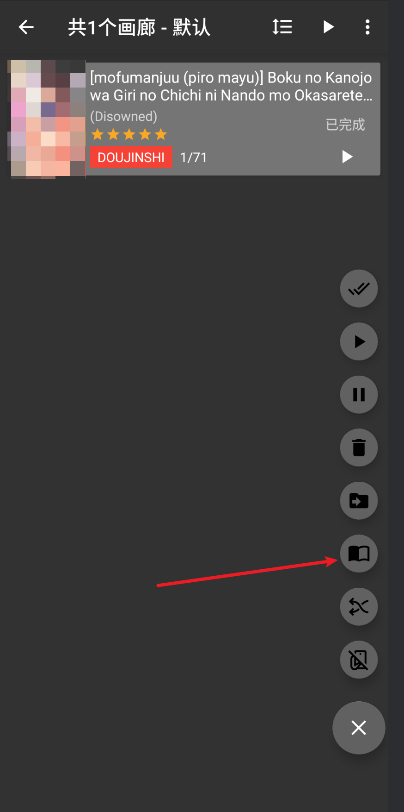
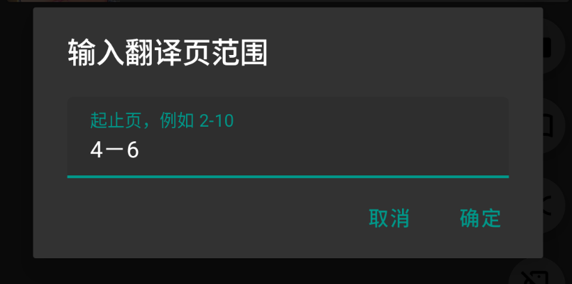

# EhViewer 自动翻译（自用）

本仓库仅用于为 EhViewer 增加“图片内文本翻译”能力，聚焦翻译相关逻辑与使用说明。内容仅供个人自用与研究，不提供技术支持，接口与行为可能随时变更。

Fork 来源：基于 `Ehviewer_CN_SXJ` 仓库二次开发并聚焦翻译功能，上游仓库 `https://github.com/xiaojieonly/Ehviewer_CN_SXJ`；原始项目 `EhViewer` 由 `seven332` 开发（`https://github.com/seven332/EhViewer`）。

## 功能概览
- 大模型单页翻译：在阅读页对当前图片进行遮罩与生成式翻译，生成译后图片并保存到 `translated` 子目录，页面会自动刷新显示。
- 普通批量翻译：将整本画廊打包为 zip 上传至本地服务，由服务端执行检测、OCR、擦写/重绘、翻译与导出，客户端轮询进度并下载结果。
- 使用定位：仅用于方便一键机翻，效果可能差强人意，适用于懒得手动修的，可在手机上直接翻译。
- 交互能力：支持在阅读页进行“译文/原文”切换，便于比对与回退。
- 支持范围翻译：可在普通批量翻译中选择翻译范围（例如2-5，代表第2页到第5页），默认全部。

## 演示

翻译配置（1–2）：在设置中填写普通服务主机/端口并测试连接；配置大模型的基地址、模型、通用提示词与 `API Key`。点击图片可查看原图。

<table>
  <tr>
    <td align="center" valign="top">
      
      
演示1：设置阅读是否优先显示翻译版本

    </td>
    <td align="center" valign="top">
      
      
演示2：翻译服务配置

    </td>
  </tr>
  <tr><td colspan="2" style="height:12px"></td></tr>
</table>

## 下载地址

[//]: # (- [Appteka]&#40;https://appteka.store/app/acdr168648&#41;)
- [百度云](https://pan.baidu.com/s/1Vp7H8NhuUix33BZCpfX_pA) 提取码：26d1
- [夸克网盘](https://pan.quark.cn/s/a2a1bdc3a742) 提取码：S31f
- [蓝奏云](https://wwbfg.lanzoum.com/i4AyK4eewfmh)，电脑端可正常下载 提取码：f3bu
- [GitHub](https://github.com/xiaojieonly/Ehviewer_CN_SXJ/releases)
- Torrent链接:magnet:?xt=urn:btih:9952183b0cfe6436777c0e98647b3b679918d3fa&xt=urn:btmh:12204c2d4243e981d7677c80bb16bcc1192051fe5b85569905974fd152a54682ecf6&dn=EhViewer-2.0.2.7.apk&xl=28245951

# Changelog

## 2026/11/02
### 新版发布2.0.2.7
- 添加本地导入筛选功能
- 修复导入本地画廊信息时可能崩溃的问题
- 新增从 CBOR 格式读取本地画廊的功能
- 汞齐 ：avoid leaking the buffer global ref in create stream helpers (#2878)

## 2026/10/21
### 新版发布2.0.2.6 
- 表站图床host过期，紧急修复
- [百度云](https://pan.baidu.com/s/1Wh2RFStPi3kXZfcukrzMFA) 提取码：7ygg
- [夸克网盘](https://pan.quark.cn/s/208df8b1b622) 提取码：wjVU
- [蓝奏云](https://wwbfg.lanzoum.com/ip60n4cuuj0b)，电脑端可正常下载 提取码：a8rq
- [GitHub](https://github.com/xiaojieonly/Ehviewer_CN_SXJ/releases)
- Torrent链接:magnet:?xt=urn:btih:998657a2387c0b12ff251fb74b586e0c3f3fdeba&xt=urn:btmh:122070097613c643682396a645c26a601777e7b127e999621aa417f224113e8363a8&dn=EhViewer-2.0.2.6.apk&xl=28229547

## 2026/10/01
### 新版发布2.0.2.5 国庆节快乐~

- 为 Gallery_Tags 增加 LOCATION 标签分类，并同步更新相关数据库处理
- 改进 SpiderInfo 解析并增强 RestoreDownloadPreference 功能
- 添加阅读刷新率设置功能
- 重构下载页，新增下载归档导入、批量操作、选择监听器、搜索控制器及分页控制器
- 修复阅读进度重置功能 by: Mios-dream
- 添加本地相册导入功能
- 修复归档解压因文件名超长导致的导入失败
- [百度云](https://pan.baidu.com/s/1COJPa_ZtIWFtvEvuYmZd7A) 提取码：e13i
- [夸克网盘](https://pan.quark.cn/s/1e9696cf63ae) 提取码：dY97
- [蓝奏云](https://wwbfg.lanzouu.com/iNrjO4afcy0b)，电脑端可正常下载 提取码：fobb
- [GitHub](https://github.com/xiaojieonly/Ehviewer_CN_SXJ/releases)
- Torrent链接:magnet:?xt=urn:btih:9566ada427877a16f0a95e26c54223c10e131fa3&xt=urn:btmh:1220b9a286b9fd236df79d91f6fdc1c77682890e2f6b368ae66d58740cb2cdad433a&dn=EhViewer-2.0.2.5.apk&xl=28229476

## 2026/09/01 
### 新版发布2.0.2.4 

- 更新Gradle插件和Gradle包装器版本
- 增强异常处理，捕获 NoSuchElementException 以避免潜在的错误
- 添加读取画廊信息头的功能，优化内存处理并增强异常捕获
- 添加封面图像对话框功能，优化下载服务通知和动画效果
- 重构SelectItemWithIconAdapter为Kotlin并删除旧Java实现
- 更新归档下载功能，重构下载管理器为Kotlin，添加新服务和进度通知，添加暂停继续下载功能
- 在更新对话框中增加支持链接与赞助按钮
- 猫尾草: 抽离下载信息监听器接口
- [百度云](https://pan.baidu.com/s/1pJl_NzCt46YlLv494kUuKw) 提取码：9mej
- [夸克网盘](https://pan.quark.cn/s/873901763b79) 提取码：ULkh
- [蓝奏云](https://wwbfg.lanzouu.com/iqgrh3zxrdah)，电脑端可正常下载 提取码：73tu
- [GitHub](https://github.com/xiaojieonly/Ehviewer_CN_SXJ/releases)
- Torrent链接:magnet:?xt=urn:btih:7289464887abcd77f106c84f7ab395e5d6e74465&xt=urn:btmh:122013a4f6850078100eab8e49819aa9a34f29c1f88856089413cf2bf236453d4302&dn=EhViewer-2.0.2.3.apk&xl=27747455

## 2026/09/01
### 新版发布2.0.2.4

- 更新Gradle插件和Gradle包装器版本
- 增强异常处理，捕获 NoSuchElementException 以避免潜在的错误
- 添加读取画廊信息头的功能，优化内存处理并增强异常捕获
- 添加封面图像对话框功能，优化下载服务通知和动画效果
- 重构SelectItemWithIconAdapter为Kotlin并删除旧Java实现
- 更新归档下载功能，重构下载管理器为Kotlin，添加新服务和进度通知，添加暂停继续下载功能
- 在更新对话框中增加支持链接与赞助按钮
- 猫尾草: 抽离下载信息监听器接口

## 2026/08/01
### 新版发布2.0.2.3 建军节快乐~

- 修复页码显示延迟的问题
- 添加重置阅读进度功能以更新UI
- 更新 AboutFragment 以使用 setPreferencesFromResource，确保仅在满足条件时设置偏好项点击监听器
- 修复drawable赋值逻辑以避免潜在的空指针异常
- 增强图像解码错误处理，避免空值返回并记录警告
- 添加获取可编辑评论的功能，更新相关解析器和UI逻辑
- [百度云](https://pan.baidu.com/s/1pJl_NzCt46YlLv494kUuKw) 提取码：9mej
- [夸克网盘](https://pan.quark.cn/s/873901763b79) 提取码：ULkh
- [蓝奏云](https://wwbfg.lanzouu.com/iqgrh3zxrdah)，电脑端可正常下载 提取码：73tu
- [GitHub](https://github.com/xiaojieonly/Ehviewer_CN_SXJ/releases)
- Torrent链接:magnet:?xt=urn:btih:7289464887abcd77f106c84f7ab395e5d6e74465&xt=urn:btmh:122013a4f6850078100eab8e49819aa9a34f29c1f88856089413cf2bf236453d4302&dn=EhViewer-2.0.2.3.apk&xl=27747455

## 2026/08/01
### 新版发布2.0.2.2

- 修复了浏览历史未正确保存的问题
- 修复评论时输入框被键盘遮挡的问题
- [百度云](https://pan.baidu.com/s/1rh-lvEc-QjiMtfPi6T1BKA) 提取码：7p6z
- [夸克网盘](https://pan.quark.cn/s/0de32f69e12a) 提取码：SnVD
- [蓝奏云](https://wwbfg.lanzouu.com/iWAFL3uefh8d)，电脑端可正常下载 提取码：3txx
- [GitHub](https://github.com/NotFaceGUI/EhViewer-Auto-Translation-Ver/releases)
- Torrent链接:magnet:?xt=urn:btih:ec1403341edaba853b0836d2d3c5976498572a3c&xt=urn:btmh:1220453fdf4272b27c81d88a4ddae25a64ca524a13e53f835430b4acacb2e7ae3bcb&dn=EhViewer-2.0.2.2.apk&xl=27747451

普通翻译流程（3–6）：在下载页选择“上传翻译”（支持范围选择），上传打包 zip；客户端轮询服务进度；结果下载到 `translated` 目录并自动刷新，阅读页可在“译文/原文”间切换。

<table>
  <tr>
    <td align="center" valign="top">
      
      
演示3：在下载列表选择需要翻译的作品

    </td>
    <td align="center" valign="top">
      
      
演示4：范围选择

    </td>
  </tr>
  <tr>
    <td align="center" valign="top">
      
      
演示5：翻译队列进度显示

    </td>
    <td align="center" valign="top">
      
      
演示6：译后展示

    </td>
  </tr>
</table>

大模型单页翻译（7–9）：在阅读页菜单选择“大模型翻译本页”（可先遮罩文本区域）；展示生成式翻译效果；对提示词增加“上色”等样式后展示改进示例。

<table>
  <tr>
    <td align="center" valign="top">
      
      
演示7：选择大模型翻译本页

    </td>
    <td align="center" valign="top">
      
      
演示8：大模型翻译效果

    </td>
    <td align="center" valign="top">
      
      
演示9：提示词上色后的效果

    </td>
  </tr>
</table>

# Changelog
## 2026/07/17
### 新版发布 2.0.2.3-at

- **评论/标题翻译**：详情页和评论列表页支持翻译标题与评论，点击右下角"译"按钮即可翻译，再次点击切回原文
- **评论文本保留链接**：翻译评论时保留原始 HTML 标签和链接，原样输出只翻译文字内容
- **标题智能翻译**：标题翻译只翻译作品名，保留社团名、作者名、系列名等元数据不变
- **翻译设置增强**：新增"文本翻译模型"设置，可选择已配置的 OpenAI 兼容 Provider 用于评论/标题翻译
- **翻译方式预设**：移除每次翻译时选择"大模型/本地"的弹窗，改为设置页预设默认方式，一键翻译更快捷
- 版本号后缀从 `-llm` 改为 `-at`
- 新增支持 BallonsTranslator / manga-translator-ui 本地服务的 API 调用，与现有 API 接口兼容

## 自用声明

- 本项目仅满足作者个人使用场景，不保证稳定性与兼容性，不保证与上游仓库的同步更新。
- 不提供任何账号、密钥或云资源，也不保证第三方服务可用性。
- 使用造成的风险与后果由使用者自行承担，请勿用于任何违规用途。
 - 软件包分离与数据隔离：本软件与原始 EhViewer 的安装包分离，数据默认隔离。可使用“导出软件数据”功能进行同步与迁移（导出为数据库文件后在另一侧导入）。

## 大模型的局限与策略

- NSFW 限制：生成式模型可能拒绝或弱化成人内容，或输出不完整。策略为仅遮罩气泡/文本区域、弱化提示词、必要时降级为普通服务。
- 批量限制：成本与速率限制，以及额外的内容审查导致批量不太理想，仅在必要时使用大模型，故“不支持使用大模型进行批量翻译”。批量需求请使用下述普通服务方案。
- 质量与排版：生成图可能尺寸不一致或出现边缘瑕疵，客户端会缩放并做透明背景处理，但仍可能存在错位或风格不一致。
- API 依赖：需自备 `API Key`，模型与基地址可在应用设置内配置通用提示词与模型参数。

## 普通翻译需要自建服务

- 需要本地或内网运行一个 HTTP 服务（默认 `http://0.0.0.0:8000`）。
- 客户端调用的接口约定：
  - `GET /`：连通性测试。
  - `POST /translate`：表单上传 `zip`（整本）或 `file`（单张），返回 `{"job_id": "..."}`。
  - `GET /status?job_id=...`：查询任务进度与状态。
  - `GET /current_job`：获取当前任务信息。
  - `POST /cancel_current`：取消当前任务。
  - `GET /result?job_id=...`：下载翻译结果（打包输出）。
- 端口与主机在应用“设置-翻译设置”中配置：`translation_base_host/服务器主机`、`translation_base_port/服务器端口`。
- 输出格式建议 `webp`, 保持与输入相同的尺寸与质量。

- 推荐服务端方案：
  - **BallonsTranslator / manga-translator-ui**：基于 `hgmzhn/manga-translator-ui`，内置 API 服务（接口与本项目完全兼容）。部署与依赖说明见其 README。
  - 仓库地址：`https://github.com/NotFaceGUI/manga-translator-ui-dev`
  - 启动手机端 API 服务：`launch_jobs_api.py --port 8001`（或双击 `启动5-手机API服务.bat`）
  - 在应用中配置"设置-翻译设置"：填入服务主机与端口（默认 8001），使用"测试连接"确认可用后即可开始上传 zip/单页进行翻译。
  - 配置通过软件本身的 `examples/config.json` 管理，API 不支持远程修改。

## 配置提示

- 大模型相关：可在设置中配置基地址、模型、通用提示词及 API Key。
- 普通服务相关：在设置中填入服务主机与端口后，可使用“测试连接”验证连通性。
- 模型支持范围：仅支持 Gemini API 的格式的模型。

## 目录与输出

- 译后图片保存在对应画廊下载目录的 `translated` 子目录下。

## 免责声明

- 以上功能与接口均可能调整，不保证长期兼容与可用。
- 本项目不承诺问题修复或用户支持，请谨慎评估并自行建设所需基础设施。
